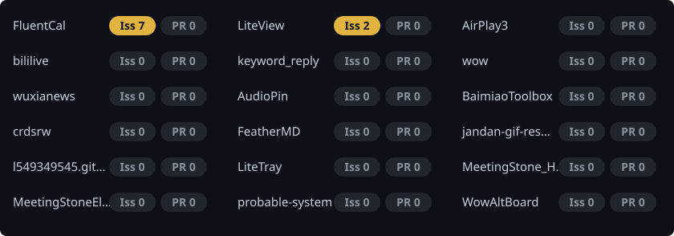
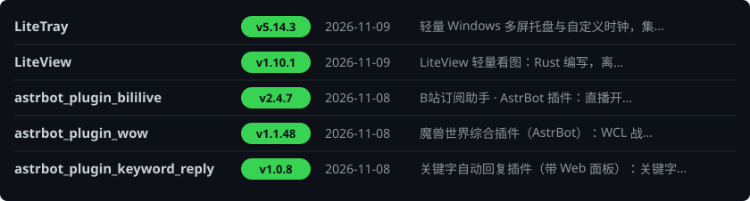

<picture>
  <source media="(prefers-color-scheme: dark)" srcset="https://raw.githubusercontent.com/Lianzy-Baimiao/Lianzy-Baimiao/output/snake-dark.svg" />
  <source media="(prefers-color-scheme: light)" srcset="https://raw.githubusercontent.com/Lianzy-Baimiao/Lianzy-Baimiao/output/snake.svg" />
  
</picture>

<!-- issues-pr:start -->

#### 待处理 · Issues & PR

 

<!-- issues-pr:end -->

<!-- recent:start -->

#### 近期更新 · Recent Releases

<!-- recent:end -->
