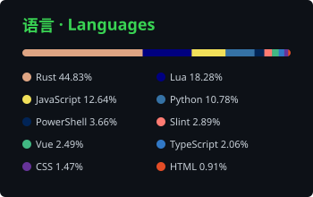

<picture>
  <source media="(prefers-color-scheme: dark)" srcset="https://raw.githubusercontent.com/Lianzy-Baimiao/Lianzy-Baimiao/output/snake-dark.svg" />
  <source media="(prefers-color-scheme: light)" srcset="https://raw.githubusercontent.com/Lianzy-Baimiao/Lianzy-Baimiao/output/snake.svg" />
  
</picture>

#### 语言 · Languages

<!-- issues-pr:start -->

#### 待处理 · Issues & PR

 

<!-- issues-pr:end -->

<!-- recent:start -->

#### 近期更新 · Recent Releases

| 项目 | 版本 | 日期 | 简介 |
| --- | :-: | :-: | --- |
| [astrbot_plugin_bililive](https://github.com/Lianzy-Baimiao/astrbot_plugin_bililive) | [v2.4.7](https://github.com/Lianzy-Baimiao/astrbot_plugin_bililive/releases/tag/v2.4.7) | 2026‑11‑08 | B站订阅助手 · AstrBot 插件：直播开播… |
| [astrbot_plugin_wow](https://github.com/Lianzy-Baimiao/astrbot_plugin_wow) | [v1.1.48](https://github.com/Lianzy-Baimiao/astrbot_plugin_wow/releases/tag/v1.1.48) | 2026‑11‑08 | 魔兽世界综合插件（AstrBot）：WCL 战绩… |
| [astrbot_plugin_keyword_reply](https://github.com/Lianzy-Baimiao/astrbot_plugin_keyword_reply) | [v1.0.8](https://github.com/Lianzy-Baimiao/astrbot_plugin_keyword_reply/releases/tag/v1.0.8) | 2026‑11‑08 | 关键字自动回复插件（带 Web 面板）：关键字/… |
| [LiteTray](https://github.com/Lianzy-Baimiao/LiteTray) | [v5.13.0](https://github.com/Lianzy-Baimiao/LiteTray/releases/tag/v5.13.0) | 2026‑11‑08 | 轻量 Windows 多屏托盘与自定义时钟，集成… |
| [FluentCal](https://github.com/Lianzy-Baimiao/FluentCal) | [v0.3.9](https://github.com/Lianzy-Baimiao/FluentCal/releases/tag/v0.3.9) | 2026‑11‑08 | 钉在 Windows 桌面上的日历与甘特图：农历… |

<!-- recent:end -->
